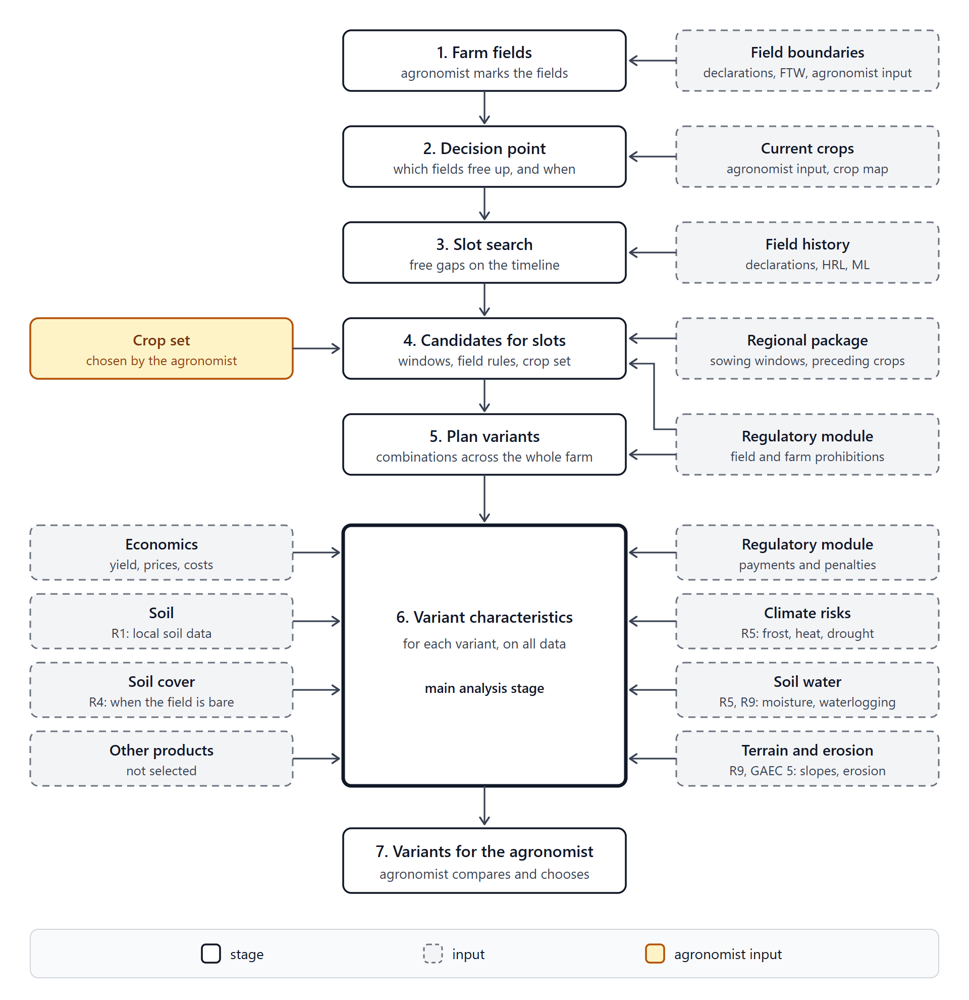

# Field Shift

Crop-rotation decision support built on NASA Earth observation data, for the NASA Space Apps Challenge 2026, challenge "Field Shift: Adapting Farms with NASA Data". Piloted on 12 real declared fields in Lithuania (102 ha near Vilkaviškis).

The application shows what NASA satellites see on the farm (soil cover from HLS, rain from GPM IMERG, temperature from NASA POWER, relief from NASADEM), turns it into numbers per field, and uses those numbers to compare crop plans for the next two harvests. It does not choose for the agronomist: it shows the plans, what differs between them and why.

Its angle is **soil protection, measured and not assumed**: every plan is measured on how long it leaves the soil without living cover, counted by how erosive the rain is at that time of year (NASA HLS × NASA GPM IMERG), and on five more soil measures. One plan is "Best for soil", with its price in days and €/ha. How it is computed: [docs/soil.md](docs/soil.md).

## How it works

The application follows the agronomist's path in seven stages. Stages 1–5 answer "what is possible at all"; stage 6 measures every possible plan on all the data; stage 7 leaves the choice to the agronomist.



| # | Stage | What the system does | Where |
|---|---|---|---|
| 1 | Farm fields | Takes the fields of the whole farm | Map |
| 2 | Decision point | Finds which fields free up and when, from what grows now | Fields |
| 3 | Slot search | Builds the timeline of each field and finds the free gaps up to the plan horizon | Fields, `src/engine/plan.ts` |
| 4 | Candidates | Admits a crop to a slot if its sowing window fits, its harvest ends before the next crop, and no field rule forbids it | Crops, `src/engine/plan.ts` |
| 5 | Plan variants | Searches for combinations across all fields that pass the farm rules | `src/engine/search.ts` |
| 6 | Variant characteristics | Measures every variant the same way: money over past seasons with each field's index from HLS and the wet-harvest loss from IMERG ([docs/money.md](docs/money.md)); soil protection in six measures from HLS cover and IMERG rain ([docs/soil.md](docs/soil.md)); dry seasons from IMERG and POWER; rotation | Fields, Satellite, Analytics, `src/engine/characteristics.ts` |
| 7 | Variants for the agronomist | Shows usual practice (a typical farm of the area, drawn from the field declarations: [docs/usual-practice.md](docs/usual-practice.md)) and the best variant for each measure (highest margin, best in a bad year, best for soil, balanced) and lets the agronomist compare, edit and choose | Planner, Checks |

Principles behind it:

- **A field is a timeline of slots**, not "a crop for the year". Winter crops, spring crops and catch crops are special cases of a slot.
- **The plan covers the whole farm**, because some rules are checked across all fields together.
- **Variants are built first, then each is evaluated on all data.**
- **NASA data enter through products**: a conclusion drawn from data that answers a question about a field, for example "in which months is this field bare".
- **The system does not choose for the agronomist.** There are no priority weights.

In the diagram, R1, R4, R5 and R9 are requirement numbers of the challenge page; the source of the picture is [docs/framework.svg](docs/framework.svg).

## Run

```bash
npm install
npm run dev        # http://localhost:3000
npm test           # engine unit tests (vitest)
npm run build      # production build; needs a Node server because of the assistant route
npm run shots      # screenshots of every state at the regular desktop width (1280 px), and a fit report (needs npm run dev)
npm run check:day -- 2026-11-14   # the same app on another decision day, on port 3111 (see "The decision day")
```

TypeScript on Node 24, Next.js 16, React 19, MapLibre GL. The engine runs in the browser; the search for plans runs in a Web Worker. The only server code is `/api/assistant`.

Copy `.env.example` to `.env`. `GEE_KEY` and the CDSE S3 keys (`CDSE_S3_ACCESS_KEY`, `CDSE_S3_SECRET_KEY`, for Copernicus HRL Crop Types) are needed only to rebuild the data (`pipeline/`); `ANTHROPIC_API_KEY` only for the assistant chat. Every screen works without both.

## The decision day

The demo replays the decision the farm faced on one day: **1 August 2026**, `DECISION_DATE` in `src/pilot/demo.ts`. The rapeseed is harvested, the cereal harvest is starting, winter rapeseed must be sown within three weeks: the last day on which the whole plan for 2027 is still open, a catch crop for this autumn included.

- **The plan uses only data from before that day.** `PLAN_DATA` in `src/pilot/demo.ts` lists every dataset behind the plan with its last day, and a test fails if one runs past the decision day. Satellite layers observed later are shown with the label "after the decision day — not used by the plan".
- **Everything else follows from the constant**: the plan years, what stands on the fields and what is already sown, which seasons the field index may use (`fieldIndexAt`), which satellite observations the screens show as known (`src/pilot/satellite.ts`), the texts.
- **Supported days**: 1 July – 31 December 2026 (`SUPPORTED_DAYS`); outside it the app stops with an explanation, because the field histories and the cover model are prepared for this range.
- **Checking another day**: `npm run check:day -- 2026-11-14` starts the app on that day on port 3111, next to the dev server; `BASE=http://localhost:3111 OUT=screenshots-check node scripts/shots.mjs 1280` photographs every state. `tests/demo-date.test.ts` runs the engine on nine days of the range.
- **After changing the day**: `npm test`, `npx tsx pipeline/92_soil_sensitivity.ts` (the numbers the "?" panel quotes under "what we checked"), `npm run shots`.

## Layout

| Path | Contents |
|---|---|
| `src/engine/` | The planning logic, independent of the interface: `plan.ts` (field timelines, free slots, candidate crops), `search.ts` (search for farm plans, comparison), `characteristics.ts` (what each plan is measured on), `editor.ts` (the agronomist's own plan), `explain.ts` (plain-language reading of a plan) |
| `src/pilot/` | Everything bound to the Lithuanian pilot: `regional.ts` (crop reference), `rules.ts` (EU farm-payment conditions with the thresholds that apply in Lithuania, payment rates), `demo.ts` (the farm, the decision day, the plan set-up, the replayed seasons), `economics.ts` (money constants), `soil.ts` (soil climate, humus coefficients, sources of the soil numbers), `satellite.ts` (what NASA HLS saw on the fields, cut at the decision day) |
| `src/data/` | Inputs of the pilot farm, all built by `pipeline/` |
| `src/app/` | One folder per screen, `api/assistant/route.ts`, `globals.css` (the design system) |
| `src/components/` | Frame, store, map, timeline, charts, 30 m grid, the vocabulary of explained terms (`glossary.ts`), chat, the soil block and its "?" panel (`Soil.tsx`), small building blocks (`ui.tsx`) |
| `pipeline/` | Scripts that build `src/data` from NASA and Lithuanian sources: [pipeline/README.md](pipeline/README.md) |
| `tests/` | Unit tests of the engine, the plan editor, the money, the soil measures, the satellite products and the decision day |
| `docs/` | The framework diagram (`framework.svg` and its PNG); [money.md](docs/money.md): how the engine computes the money of a plan; [soil.md](docs/soil.md): how it measures soil protection; [usual-practice.md](docs/usual-practice.md): how usual practice is drawn from what farms around the pilot sow |
| `scripts/shots.mjs`, `scripts/check-day.mjs` | Screenshots of every state and the fit report (`screenshots/`, not committed); the app on another decision day |

## Screens

| Group | Screen | What it does |
|---|---|---|
| Farm | Map | Declared fields around the farm, the farm's fields, the official rule areas |
| Farm | Fields | The previous season on each field: its crop (pre-filled from the declarations, editable), whether it is harvested on the decision day and when the field is free for the next crop, and, once sowing has started, what is already sown; a satellite hint from before that day; field timelines with sowing and harvest windows and free slots |
| NASA data | Satellite | One layer as 30 m pixels and numbers per field; two layers side by side with a pixel inspector |
| NASA data | Analytics | When fields are bare (HLS), when rain is erosive and when water drains through the soil (IMERG, POWER); which months are risky; risk zones; the method behind each number |
| Plan | Crops | Crops the farm can grow, catch crops, limits |
| Plan | Planner | Suggested plans with the soil-protection block and its "?" panel (`?help=soil`), comparison, the agronomist's own plan, "Choose this plan" and the sowing list |
| Plan | Checks | The farm rules applied to a plan |

Tabs and views are in the URL (`/planner?tab=compare`, `/analytics?tab=zones&view=dry`), so every state can be linked and photographed. The button to the next screen of the path is always at the right end of the top bar (`NEXT` in `src/components/Shell.tsx`); Checks, the last screen, has none.

**Terms are explained where they stand.** There is no glossary screen: a term such as NDVI, HLS, erosive rain or humus balance has a dotted underline at its first mention in each panel, card, table or note, and its plain-language explanation appears on hover or keyboard focus (`<Term>` in `src/components/ui.tsx`). The explanations are one list, `src/components/glossary.ts`, which the assistant also receives.

## What is real and what is not

- Real: field boundaries, crops 2024–2026, satellite series, weather, yields, prices, payment rates, the erosion-sensitive and peat layers.
- Preset: the decision day (1 August 2026), the crop set, and, for decision days after the autumn sowing, which crops are in the ground (`SOWN_IN_AUTUMN`). The crops of 2026 are pre-filled from the paying agency's layer and can be corrected on the Fields screen.
- Illustrative: variable costs per crop (no open source exists for Lithuania); preceding-crop yield factors (literature).
- From farm accounts: the costs of running the farm (overheads, depreciation, rent, wages, interest; 491 €/ha) of Lithuanian cereal farms in 2024 (FADN), the same for every plan. Margins are farm net income.
- Estimates: the extra grain moisture and the feed share of wheat in a wet harvest (drying tariffs are published).
- Soil numbers: cover and erosive rain are measured (NASA HLS, NASA GPM IMERG); harvest on wet soil and bare soil in the leaching season are unvalidated proxies; the humus balance is an accounting with published coefficients. None is an erosion rate or measured carbon ([docs/soil.md](docs/soil.md)).
- The farm is 12 neighbouring declared fields, not one real holding: open declarations carry no farm identifier.
- The application is limited to the preloaded farm: drawing arbitrary fields is not supported.

## Data and licences

The sources of every data file are listed per script in [pipeline/README.md](pipeline/README.md). Two inputs committed here come from services that carry no explicit licence text: the erosion-sensitive and peat layers of the Lithuanian paying agency (in `src/data/farm.json`, `src/data/farm-layers.json`) and the soil map of the National Land Service (soil fields in `src/data/farm.json`).
