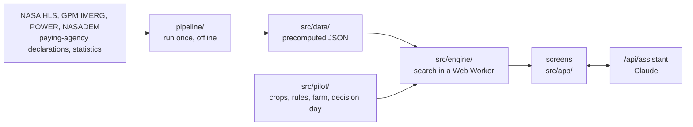

# Field Shift

Crop-rotation decision support built on NASA Earth observation data, for the NASA Space Apps Challenge 2026, challenge "Field Shift: Adapting Farms with NASA Data". Piloted on 12 real declared fields in Lithuania (102 ha near Vilkaviškis).

The application helps an agronomist plan the next two harvests of a whole farm. It finds every plan that is possible on the farm, measures each one on the same data (money over past seasons, soil protection, weather risk, the farm rules) and shows the best plan for each measure next to the plan a typical local farm would follow. It does not choose: the agronomist compares, changes and picks.

Its angle is **soil health, measured and not assumed**. Every plan gets one soil health score from 0 to 100, the average of three equal parts: soil cover (how long the plan leaves the soil bare, weighted by how erosive the rain is at that time of year; NASA HLS × NASA GPM IMERG), crop variety and organic matter. The plan with the best score is "Best for soil", shown with its price in €/ha. Details: [docs/soil.md](docs/soil.md).

## How a plan is made


Stages 1–5 answer "what is possible at all", stage 6 measures every possible plan, stage 7 leaves the choice to the agronomist.

1. **Farm fields.** The farm is a set of declared fields (Map).
2. **Decision day.** What stands on each field on the decision day and when it is free; the crops of this year are pre-filled from the paying agency and confirmed by the agronomist (Fields).
3. **Free slots.** Each field is a timeline; the gaps up to the end of the plan are the slots to fill (Fields).
4. **Candidate crops.** A crop fits a slot if its sowing window opens after the previous harvest, it is harvested before the next crop, and no preceding-crop rule, return interval or field rule forbids it. The agronomist sets which crops the farm can grow (Crops).
5. **Farm plans.** A search combines the candidates of all fields into farm plans and keeps those that pass the farm rules and that no other plan beats on every measure.
6. **Plan measures.** Every plan is measured the same way: margin in a usual and in a bad season (past seasons replayed, each field's yield adjusted by how it grows against its neighbours in NASA HLS, wet harvests from NASA GPM IMERG; [docs/money.md](docs/money.md)), the soil health score, weather risk (NASA GPM IMERG, NASA POWER), rule checks and rotation.
7. **Plans for the agronomist.** The Planner shows the typical local plan ([docs/usual-practice.md](docs/usual-practice.md)), the best plan for each measure (highest margin, best in a bad year, best for soil, balanced) and one custom plan the agronomist edits field by field; Analytics shows the data behind the numbers, Checks the rules.

Principles:

- **A field is a timeline of slots**, not "a crop for the year": winter, spring and catch crops are all just occupied intervals.
- **The plan covers the whole farm**, because some rules are checked across all fields together.
- **Plans are built first, then each is measured on all data.**
- **No priority weights.** The system shows the trade-offs; the agronomist chooses.

## Architecture



- **`pipeline/`** builds every input of the pilot farm from NASA and Lithuanian sources (Earth Engine, NASA POWER, open statistics) into `src/data/`. The app never calls these services: [pipeline/README.md](pipeline/README.md).
- **`src/engine/`** is the planning logic, independent of the interface and of Lithuania: field timelines and candidates (`plan.ts`), the search for farm plans (`search.ts`), the measures (`characteristics.ts`, `soil-score.ts`), the custom plan (`editor.ts`). It runs in the browser; the search runs in a Web Worker.
- **`src/pilot/`** holds everything bound to the Lithuanian pilot: crop reference, farm rules and payment rates, money and soil constants, the farm and the decision day.
- **`src/app/`** and **`src/components/`** are the screens and the design system (`globals.css`, `ui.tsx`). The only server code is `/api/assistant`, a chat that knows the current screen and plan.

TypeScript on Node 24, Next.js 16, React 19, MapLibre GL.

## Screens

| Screen | What it does |
|---|---|
| Map | Declared fields around the farm, the farm's own fields, official risk zones |
| Fields | What grew on each field this year and when it is free; field timelines with free slots |
| Crops | Crops the farm can grow, catch crops, limits |
| Planner | The suggested plans with money and the soil health score, the comparison table, the custom plan, the sowing list of the chosen plan |
| Analytics | The data behind the numbers: when fields are bare and rain is erosive, when the weather can hurt the selected plan's crops, risk zones |
| Checks | The farm rules applied to the selected plan |

The button to the next screen sits at the right of the top bar. Every tab and view has its own URL. Technical terms are underlined where they appear and explained on hover (`src/components/glossary.ts`).

## The decision day

The demo replays the decision the farm faced on **1 August 2026** (`DECISION_DATE` in `src/pilot/demo.ts`): rapeseed harvested, cereals being harvested, the last day on which the whole plan for 2027 is still open. The plan uses only data from before that day (`PLAN_DATA` lists them, and a test fails if one runs past it). Everything else, plan years, what stands on the fields, which satellite data count as known, is derived from that one constant. Days from 1 July to 31 December 2026 are supported; `npm run check:day -- 2026-11-14` starts the app on another day.

## Run

```bash
npm install
npm run dev        # http://localhost:3000
npm test           # engine unit tests (vitest), including nine decision days
npm run build      # production build; needs a Node server because of the assistant route
npm run shots      # screenshots of every state at 1280 px and a fit report (needs npm run dev)
```

Copy `.env.example` to `.env`. `ANTHROPIC_API_KEY` is needed only for the assistant chat; `GEE_KEY` and the CDSE S3 keys only to rebuild the data. Every screen works without them.

## Layout

| Path | Contents |
|---|---|
| `src/engine/` | Planning logic |
| `src/pilot/` | The Lithuanian pilot: crops, rules, money, soil, farm, decision day |
| `src/data/` | Precomputed inputs of the pilot farm, built by `pipeline/` |
| `src/app/`, `src/components/` | Screens, assistant route, design system |
| `pipeline/` | Data build: [pipeline/README.md](pipeline/README.md) |
| `tests/` | Unit tests of the engine, money, soil, satellite products and decision day |
| `docs/` | This diagram (`framework.svg` and its PNG), [money.md](docs/money.md), [soil.md](docs/soil.md), [usual-practice.md](docs/usual-practice.md) |
| `scripts/` | Screenshots (`shots.mjs`) and the app on another decision day (`check-day.mjs`) |

## What is real and what is not

- **Real:** field boundaries, crops 2024–2026, satellite series, weather, yields, prices, payment rates, the erosion-sensitive and peat layers, farm running costs (Lithuanian FADN 2024).
- **Preset:** the decision day and the crop set; this year's crops are pre-filled and can be corrected on the Fields screen.
- **Illustrative:** variable costs per crop (no open source for Lithuania) and preceding-crop yield factors (literature).
- **Soil numbers** compare plans; they are not erosion rates or measured carbon ([docs/soil.md](docs/soil.md)).
- The farm is 12 neighbouring declared fields, not one real holding (open declarations carry no farm identifier), and the app works only on this preloaded farm.

## Data and licences

The sources of every data file are listed per script in [pipeline/README.md](pipeline/README.md). Two inputs committed here come from services that carry no explicit licence text: the erosion-sensitive and peat layers of the Lithuanian paying agency (in `src/data/farm.json`, `src/data/farm-layers.json`) and the soil map of the National Land Service (soil fields in `src/data/farm.json`).
